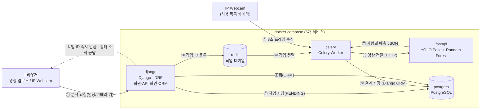
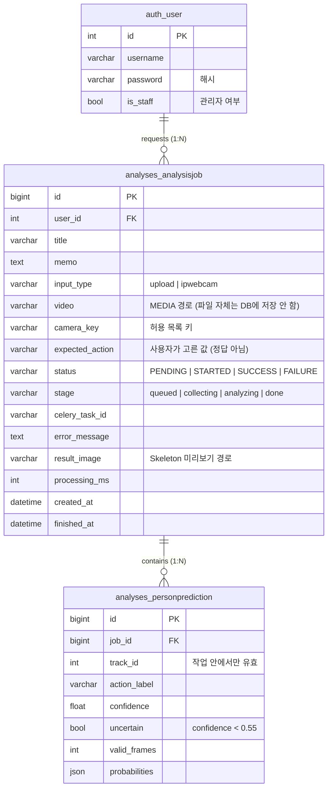
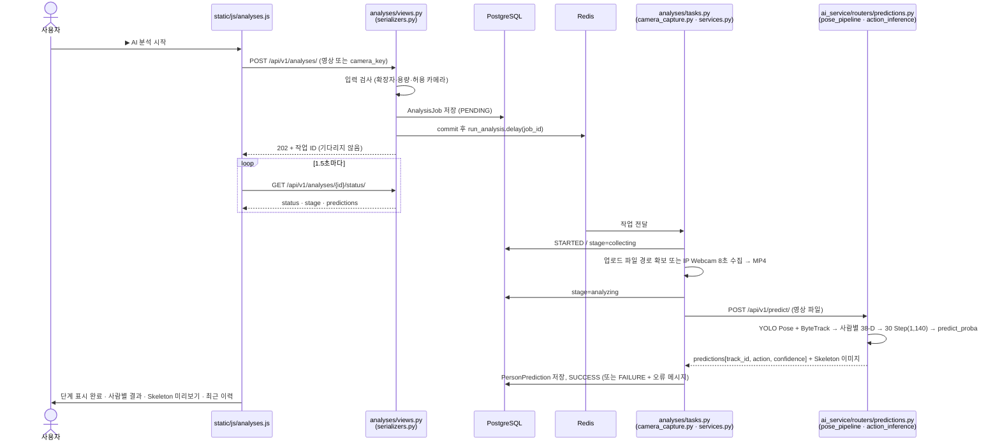
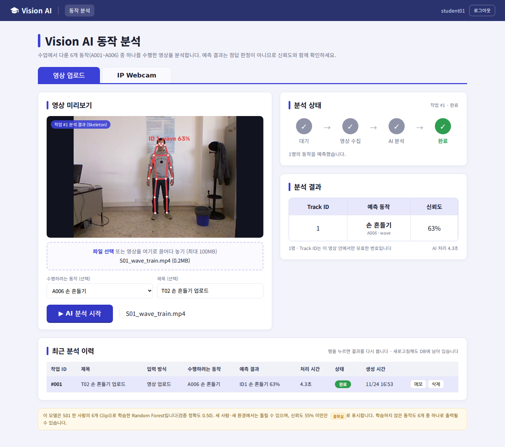
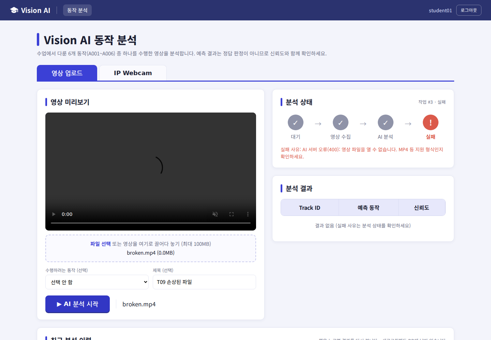
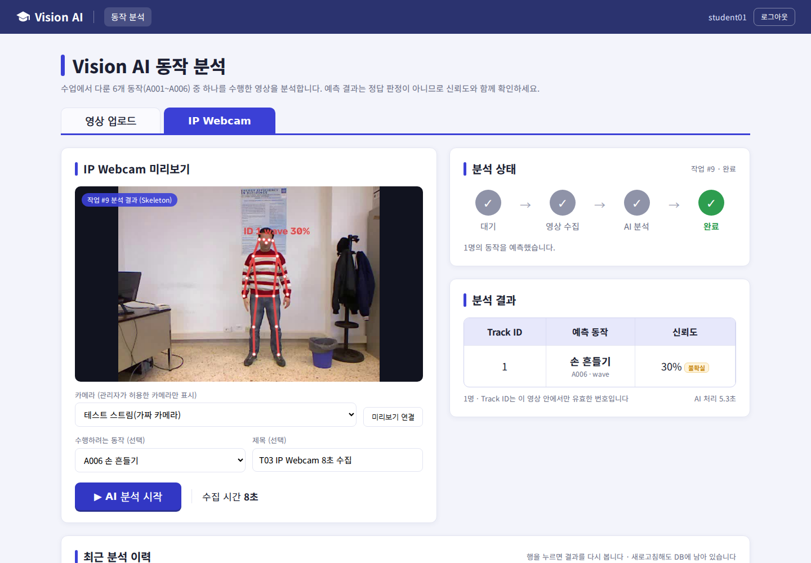
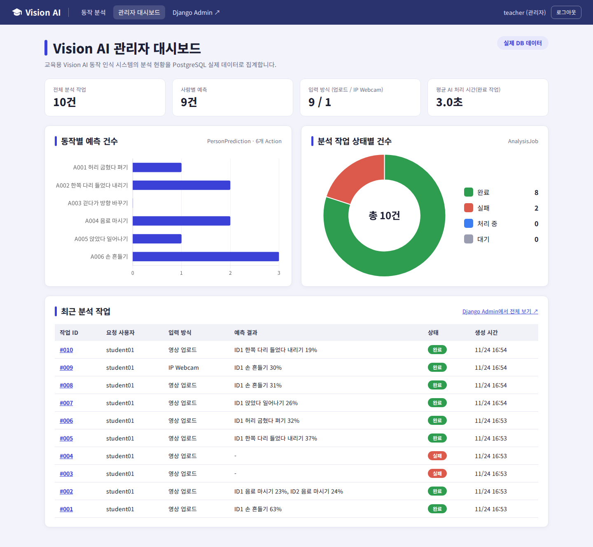
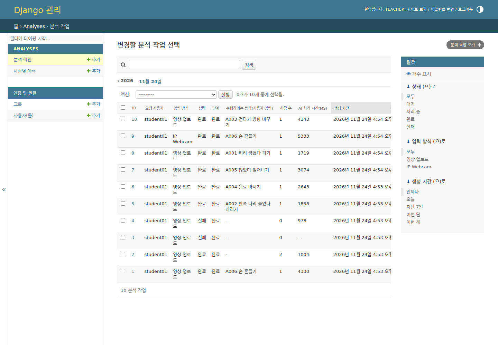

# Vision AI 동작 분석 플랫폼 (vision-action-platform-practice)

## 1. 프로젝트 소개

6일차에 학습한 **Random Forest 동작 인식 모델**(6개 Action)을 다시 학습하지 않고 그대로 가져와, 브라우저에서 AI 분석을 요청하는 웹 서비스로 만든 프로젝트입니다.
로그인한 사용자는 **영상 업로드** 또는 **IP Webcam(8초 수집)** 중 하나를 골라 `AI 분석 시작`을 누르고, 영상 속 사람(Track ID)별 예측 동작과 신뢰도를 확인합니다.
분석 요청과 결과는 PostgreSQL에 저장되고, 관리자는 Django Admin과 `/dashboard/`에서 전체 기록과 통계를 봅니다.

| 지원 동작 | A001 `bend_return` 허리 굽혔다 펴기 · A002 `leg_raise_lower` 한쪽 다리 들었다 내리기 · A003 `walk_turn_walk` 걷다가 방향 바꾸기 · A004 `drink_return` 음료 마시기 · A005 `sit_stand` 앉았다 일어나기 · A006 `wave` 손 흔들기 |
|---|---|

> 예측 Label은 정답 판정이 아닙니다. 학습하지 않은 동작도 6개 중 하나로 출력될 수 있으므로 화면에 신뢰도와 `불확실`(55% 미만) 표시를 함께 보여 줍니다.

---

## 2. 실행 방법

### 2-1. 준비물

- Docker Desktop (Compose v2)
- 6일차 학습 산출물 4개 → `ai_service/models/`에 복사 (용량이 커서 Git에 올리지 않음)

```bash
# 원본 프로젝트(subject10_pose_action)에서 복사
cp ~/ai_vision/subject10_pose_action/artifacts/day06/rf_action_baseline.joblib ai_service/models/
cp ~/ai_vision/subject10_pose_action/artifacts/day06/rf_feature_columns.json   ai_service/models/
cp ~/ai_vision/subject10_pose_action/artifacts/day06/rf_training_info.json     ai_service/models/
cp ~/ai_vision/subject10_pose_action/yolo11n-pose.pt                           ai_service/models/
```

### 2-2. 실행 순서

```bash
cp .env.example .env                 # 1) 환경변수 파일 만들기 → DJANGO_SECRET_KEY, POSTGRES_PASSWORD, IP_WEBCAM_CAMERAS 수정
docker compose up --build -d         # 2) 5개 서비스 빌드·실행 (django 시작 시 migrate 자동 실행)
docker compose ps                    # 3) postgres·redis·fastapi·django·celery 상태 확인
docker compose exec django python manage.py migrate            # (자동 실행되지만 수동으로도 가능)
docker compose exec django python manage.py createsuperuser    # 4) 관리자 계정 만들기
docker compose exec django python manage.py create_demo_users  # (선택) 시연용 teacher/student01/student02
```

| 화면 | 주소 |
|---|---|
| 사용자 분석 화면 | http://localhost:8000/analyses/ |
| 회원가입 / 로그인 | http://localhost:8000/accounts/signup/ · http://localhost:8000/accounts/login/ |
| 관리자 대시보드 (is_staff) | http://localhost:8000/dashboard/ |
| Django Admin | http://localhost:8000/admin/ |
| DRF API | http://localhost:8000/api/v1/analyses/ |
| FastAPI Swagger | http://localhost:8001/docs · 상태 http://localhost:8001/health |

### 2-3. IP Webcam 설정

- 휴대폰에 **IP Webcam** 앱 실행 → 화면에 나온 주소를 `.env`의 허용 목록에 등록합니다. 사용자는 목록의 **키**만 고를 수 있고, 임의의 URL은 입력할 수 없습니다.
  ```
  IP_WEBCAM_CAMERAS=phone|내 휴대폰|http://192.168.0.10:8080/video
  IP_WEBCAM_CAPTURE_SECONDS=8
  ```
- 휴대폰이 없을 때: 테스트용 가짜 카메라(`tools/fake_ipwebcam.py`, MP4를 IP Webcam과 같은 MJPEG 주소로 반복 송출)를 사용합니다.
  ```bash
  # samples/ 폴더에 MP4를 넣고
  docker compose --profile demo up -d fakecam     # .env: demo|테스트 스트림|http://fakecam:8090/video
  ```

### 2-4. Docker 없이 로컬 실행 (개발용)

```bash
# AI 서버
cd ai_service && uv venv --python 3.12 && uv pip install torch torchvision -r requirements.txt
.venv/bin/uvicorn main:app --port 8001
# Django + Celery (POSTGRES_DB를 비우면 SQLite, CELERY_BROKER_URL=filesystem:// 이면 Redis 없이 동작)
cd backend && uv venv --python 3.12 && uv pip install -r requirements.txt
.venv/bin/python manage.py migrate && .venv/bin/python manage.py runserver
.venv/bin/celery -A config worker -l info
.venv/bin/python manage.py test        # 자동 테스트 14개
```

---

## 3. 전체 아키텍처

`compose.yaml`이 실행하는 **5개 서비스**: `django`, `celery`, `redis`, `fastapi`, `postgres`



| 구성 요소 | 하는 일 | 하지 않는 일 |
|---|---|---|
| Django·DRF | 회원, 입력 검사, 작업 CRUD, 권한, 화면, 대시보드 집계 | AI 추론 |
| Celery Worker | 영상 확보(업로드 파일/카메라 수집), FastAPI 호출, 결과 ORM 저장 | 화면 렌더링 |
| Redis | Celery 메시지 브로커 | 업무 데이터 영구 저장 |
| FastAPI | YOLO Pose → 38-D Feature → 30 Step(1,140) → Random Forest | DB 테이블·ORM·회원 관리 |
| PostgreSQL | 사용자·작업·사람별 예측 영구 저장 | — |

---

## 4. DB 설계 (ERD)

직접 작성한 모델은 `backend/analyses/models.py`의 2개이고, 회원은 Django 기본 `auth_user`를 사용합니다.



| 테이블 | 저장하는 것 |
|---|---|
| `auth_user` | 회원 (Django 기본 제공) |
| `AnalysisJob` | 분석 요청 1건: 누가, 어떤 입력으로, 지금 어떤 상태인지, 실패 이유 |
| `PersonPrediction` | 영상 속 사람 1명의 예측. 두 사람이 나오면 작업 1건에 결과 2건 |

- 작업 삭제 시 `PersonPrediction`은 `CASCADE`로 함께 삭제되고 영상·결과 이미지 파일도 지웁니다.
- 일반 사용자는 `title`, `memo`만 수정할 수 있고 `status`·예측값은 읽기 전용입니다.

---

## 5. AI 추론 버튼 구현 흐름



---

## 6. 사용한 모델과 입력 형식

| 항목 | 내용 |
|---|---|
| 분류 모델 | `rf_action_baseline.joblib` (scikit-learn 1.9.1 RandomForest, 트리 300개) |
| Feature 순서 | `rf_feature_columns.json` — `t00_nose_x` … `t29_right_knee_angle` (1,140개). 서버 시작 시 현재 코드가 만드는 이름·순서와 일치하는지 검사 |
| 학습 정보 | `rf_training_info.json` — classes 6개, `sequence_steps=30`, `min_valid_frames=10` |
| Pose 모델 | `yolo11n-pose.pt` (COCO 17 Keypoint), 추적기 `bytetrack.yaml` |
| 재사용 코드 | `ai_service/src/` (subject10_pose_action에서 복사): `feature_utils`(정규화·관절각도), `sequence_utils`(30 Step 보간·Flatten), `multi_person_utils.feature_from_keypoints`, `pose_utils` |
| 업로드 형식 | MP4·AVI·MOV·MKV·WEBM, 100MB 이하, 최대 900 Frame 분석 |
| IP Webcam | 허용 목록 카메라에서 8초 수집 → MP4 저장 → 업로드와 같은 경로로 분석 |

**FastAPI 입출력** — `POST /api/v1/predict/` (별칭 `POST /predict/video`), multipart `file`

```json
{
  "status": "ok",                 // ok | no_person | too_short
  "message": "2명의 동작을 예측했습니다.",
  "processing_ms": 2310,
  "predictions": [
    {"track_id": 1, "action_label": "wave", "confidence": 0.6367, "uncertain": false, "valid_frames": 126, "probabilities": {"wave": 0.6367, "...": 0.0}}
  ],
  "skipped_tracks": [{"track_id": 4, "valid_frames": 4}],
  "preview_jpeg_base64": "..."
}
```

- 읽을 수 없는 파일 → `400` + 이유 → Worker가 `FAILURE`로 저장
- 영상은 정상인데 사람이 없음(`no_person`) / 유효 Pose Frame 10개 미만(`too_short`) → `200`이지만 Worker가 **판단 불가로 보고 `FAILURE` + 메시지** 저장

---

## 7. 실행 결과와 검증

> 캡처는 `tools/capture_evidence.py`(Playwright)로 Docker Compose 환경에서 자동 생성했습니다. 전체 목록: `docs/evidence/`

### 정상 분석 (영상 업로드)
입력: `S01_wave_train.mp4`(손 흔들기) → 결과: ID 1 `손 흔들기`



### 오류·실패
입력: 손상된 파일 `broken.mp4` → `실패 사유: AI 서버 오류(400): 영상 파일을 열 수 없습니다…`



### IP Webcam (8초 수집)
입력: 허용 목록 카메라 `테스트 스트림(가짜 카메라)` → 수집·분석 후 Skeleton 결과



### 관리자 대시보드 · Django Admin





### 기능 테스트 T01~T10

| 테스트 | 방법 | 결과 | 증거 |
|---|---|---|---|
| T01 모델 불러오기 | `GET :8001/health` | 6 Class · 1,140 Feature · 30 Step 일치 | `docs/evidence/T01_health.json` |
| T02 영상 업로드 | 화면에서 MP4 업로드 | 작업 등록 → SUCCESS, 사람별 결과 | `T02_upload_success.png` |
| T03 IP Webcam | 허용 카메라 8초 수집 | 수집 → 분석 → SUCCESS | `T03_ipwebcam_*.png` |
| T04 사람별 결과 | 2인 영상(SBU hugging) | 한 작업에 Track ID별 결과 2건 | `T04_two_people.png` |
| T05 비동기 | 요청 직후 응답 | 202 + 작업 ID 즉시 반환 (PENDING) | `T05_async.txt` |
| T06 영구 저장 | 새로고침 / 컨테이너 재시작 | 이력·예측 유지 | `T06_history_after_reload.png`, `T10_restart.txt` |
| T07 CRUD 권한 | student02가 student01 작업 조회·수정·삭제 | 모두 404, 목록 0건, 비로그인 403 | `T07_permission.txt`, `T07_other_user_404.png` |
| T08 관리자 | teacher로 `/dashboard/` | 차트 2개·최근 작업, 일반 회원은 차단 | `T08_*.png` |
| T09 예외 처리 | 손상 파일·사람 없는 영상·FastAPI 중단 | FAILURE + 사용자용 메시지 | `T09_*.png`, `T09_fastapi_down.txt` |
| T10 Docker | `docker compose down` → `up -d` | 작업 10건·예측 9건 그대로, 재시작 후 새 분석 SUCCESS | `T10_restart.txt` |

자동 테스트: `docker compose exec django python manage.py test` → 14개 통과 (회원가입·로그인, 권한 T07, 비동기 T05, 결과 저장 T06, 실패 기록 T09, 대시보드 T08)

### 정확도 한계

- 6일차 모델은 **S01 한 사람의 6개 Clip**으로 학습했습니다 (`rf_training_info.json`의 `subjects: ["S01"]`, `train_clips: 6`). 6일차 검증 결과는 **Accuracy 0.50, Macro F1 0.44**입니다.
- 그래서 학습 영상(S01)에서는 6개 모두 맞지만(신뢰도 0.63~0.67), 새 사람·새 환경 영상은 신뢰도가 0.2~0.4로 낮고 틀리는 경우가 많습니다.
- 틀렸을 때는 모델 교체보다 **입력 품질 → Pose → Feature → Window → 모델 → 결과 저장** 순서로 원인을 찾습니다 (`docs/error_log.md`).

---

## 8. 폴더 구조

```text
vision-action-platform-practice/
├── backend/                 Django · DRF · Celery Worker
│   ├── config/              settings · urls · celery
│   ├── accounts/            회원가입 (로그인·로그아웃은 Django 기본 뷰), create_demo_users 명령
│   ├── analyses/            models · serializers · views(API) · page_views(화면·대시보드)
│   │                        tasks(Celery) · services(FastAPI 호출) · camera_capture(IP Webcam) · admin · tests
│   ├── templates/           base · registration/login · accounts/signup · analyses/index · analyses/dashboard
│   ├── static/              css/app.css · js/analyses.js · js/dashboard.js
│   ├── requirements.txt · Dockerfile
├── ai_service/              FastAPI 추론 서버 (DB 없음)
│   ├── main.py · routers/predictions.py
│   ├── services/            model_loader · pose_pipeline · action_inference
│   ├── src/                 이전 실습 코드 복사 (pose · feature · sequence · realtime · multi_person)
│   ├── models/              joblib · json · pt  (Git 제외: *.joblib, *.pt)
│   ├── project.json · day07_realtime.json · day08_multi_person.json
│   ├── requirements.txt · Dockerfile
├── tools/                   fake_ipwebcam.py (테스트 카메라) · capture_evidence.py (캡처 자동화)
├── docs/                    evidence/ (T01~T10 증거) · error_log.md (오류 기록)
├── samples/                 테스트 영상 (Git 제외)
├── compose.yaml · .env.example · .gitignore
```

## 9. 보안·Git 주의

- `.env`(비밀키·DB 비밀번호·카메라 주소)는 Git에 올리지 않습니다. `.env.example`에는 자리표시자만 있습니다.
- `*.joblib`, `*.pt`, 영상, `media/`는 `.gitignore`로 제외합니다. 모델은 2-1의 복사 명령으로 준비합니다.
- `joblib.load()`는 직접 학습한 신뢰 가능한 모델 파일에만 사용합니다.
- 카메라 미리보기는 서버가 대신 한 장씩 가져오므로 브라우저 화면·소스에 카메라 주소가 노출되지 않습니다.
- `runserver`·`DEBUG=True`는 수업 시연용 설정입니다.
